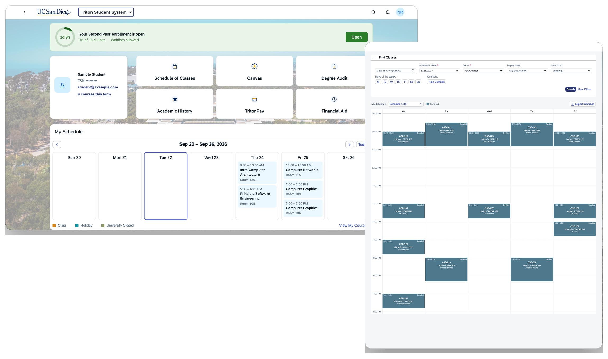

# TSSReg

An unofficial rework of UC San Diego's Triton Student System for Chrome and Firefox.

TSS was poised as a replacement for WebReg, but left a lot behind. TSSReg brings the schedule planner back, gives course search some helpful new filters, and gives the homepage a proper structure.

<u><b style="font-size: 20px;">New: Also fixes the page on Firefox!</b></u>

## Features

- Course planner with multiple saved schedules, custom events, conflict detection, and PNG export
- Quarter picker that defaults to the nearest upcoming quarter with an open enrollment pass, or the current quarter otherwise
- Final exam times and rooms for enrolled and planned courses
- Direct links from the calendar to enroll in or drop a course through TSS
- Time-of-day and conflict filters in the Schedule of Classes
- Reorganized homepage with a weekly calendar, enrollment countdowns, and unit counts by quarter
- Grouped student services menu and section shortcuts in My Personal Details

## Installation

- Chrome Web Store (coming soon)
- Firefox Add-ons (coming soon)

## Development

Run `npm run build` with Node.js to create `dist/`.

- In Chrome, enable **Developer mode** on `chrome://extensions` and load `dist/` with **Load unpacked**. [Chrome's instructions](https://developer.chrome.com/docs/extensions/get-started/tutorial/hello-world#load-unpacked)
- In Firefox 142 or later, open **This Firefox** in `about:debugging` and load `dist/manifest.json` as a temporary add-on. [Firefox's instructions](https://extensionworkshop.com/documentation/develop/temporary-installation-in-firefox/)

## Privacy

Plans and custom events stay in your browser. TSSReg sends requests only to UC San Diego’s official TSS servers and collects no telemetry. [Privacy policy](./PRIVACY.md)

TSSReg is an independent project, unaffiliated with UC San Diego.
